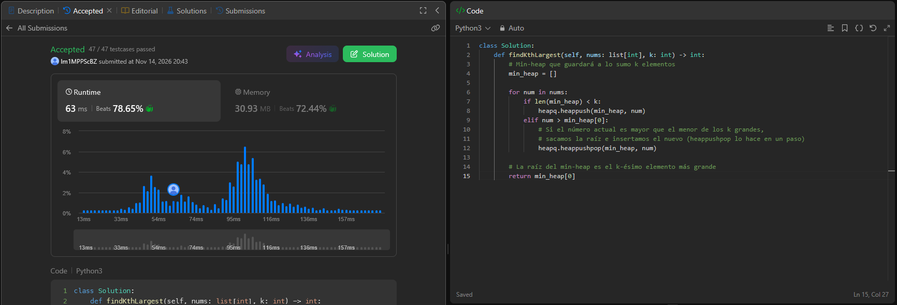
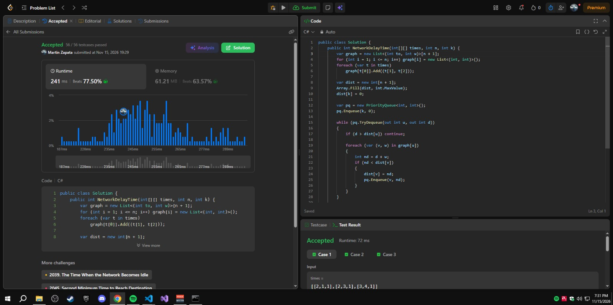
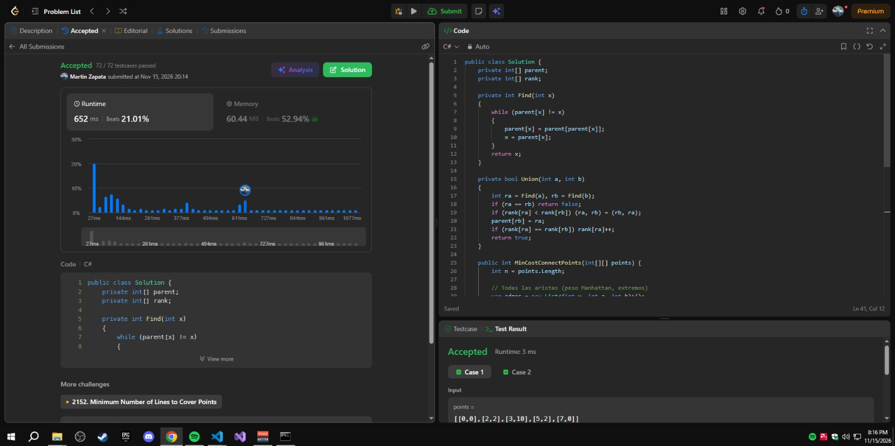
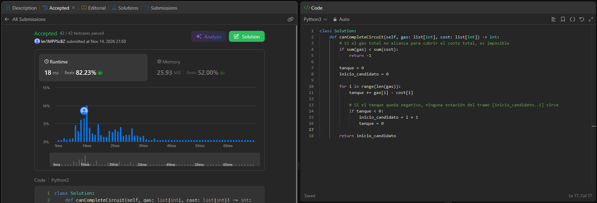
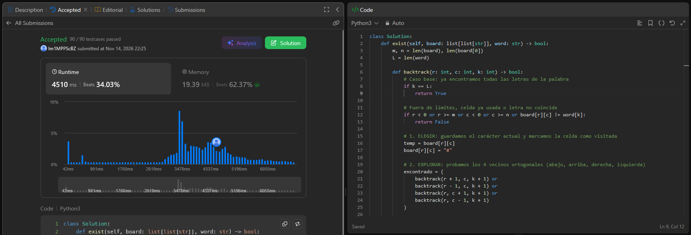

## 215. Kth Largest Element in an Array

- **Problema:** [215. Kth Largest Element in an Array](https://leetcode.com/problems/kth-largest-element-in-an-array/)
- **Autor:**  (`danielmmnez`)
- **Familia:** Heap 
- **Idea:** Mantenemos un min-heap acotado a un tamaño máximo `k`. Recorremos `nums`: mientras el heap tenga menos de `k` elementos, insertamos; si ya tiene `k` y el elemento actual supera a la raíz (el mínimo entre los `k` mejores candidatos), reemplazamos la raíz. Al finalizar, la raíz contiene el k-ésimo mayor.
- **Complejidad:** Tiempo `O(n log k)` y Espacio extra `O(k)`, donde `n = nums.length` y `k` es la capacidad máxima del heap.

## 179. Largest Number

- **Problema:** [179. Largest Number](https://leetcode.com/problems/largest-number/)
- **Autor:**  (`danielmmnez`)
- **Familia:** Ordenamiento
- **Idea:** Convertimos los enteros a cadenas y ordenamos mediante un comparador personalizado donde `a` precede a `b` si la concatenación `a + b` es lexicográficamente mayor que `b + a`. Finalmente concatenamos el arreglo ordenado y controlamos el caso borde donde todos los elementos son ceros devolviendo `"0"`.
- **Complejidad:** Tiempo `O(n log n · d)` (donde `n = nums.length` es la cantidad de números y `d` la longitud promedio de los dígitos al comparar cadenas) y Espacio `O(n)` para almacenar las cadenas y el resultado.

## 743. Network Delay Time
 
- **Problema:** [743. Network Delay Time](https://leetcode.com/problems/network-delay-time/)
- **Autor:** Martin Zapata (`Suprimirx`)
- **Familia:** Grafos (Dijkstra)
- **Idea:** Modelamos la red como un grafo **dirigido y ponderado** con lista de adyacencia: los vértices son los nodos `1…n` y cada arco `u → v` pesa `w` (el tiempo de la señal). Ejecutamos Dijkstra desde `k` con un min-heap (`PriorityQueue`) de distancia tentativa: extraemos el nodo de menor tiempo acumulado, que al ser los pesos no negativos ya no puede mejorar, y relajamos sus arcos (`dist[u] + w < dist[v]`). Como el heap no tiene *decrease-key*, insertamos una entrada nueva en cada mejora e ignoramos las entradas obsoletas al extraerlas. La respuesta es la **mayor** distancia finita, porque hay que esperar al nodo que más tarda; si algún nodo queda en infinito devolvemos `-1`. No usamos BFS porque los arcos no pesan lo mismo, ni Floyd–Warshall porque hay un solo origen.
- **Complejidad:** Tiempo `O((n + m) log n)` y Espacio `O(n + m)`, donde `n` es el número de nodos y `m = times.length` el número de arcos.

## 1584. Min Cost to Connect All Points
 
- **Problema:** [1584. Min Cost to Connect All Points](https://leetcode.com/problems/min-cost-to-connect-all-points/)
- **Autor:** Martin Zapata (`Suprimirx`)
- **Familia:** Grafos (árbol de recubrimiento mínimo, **Kruskal**)
- **Idea:** Modelamos los puntos como vértices de un grafo **completo, no dirigido y ponderado**, donde el peso de cada pareja es la distancia de Manhattan `|x₁ − x₂| + |y₁ − y₂|`. No hay origen: se minimiza la suma de las aristas de un árbol que conecte a todos. Generamos las `n(n−1)/2` aristas, las ordenamos por peso y las recorremos con **Union-Find** (compresión de caminos y unión por rango): si los extremos están en componentes distintas, unimos y sumamos el peso; si ya están en la misma, la arista cierra un ciclo y se rechaza. Nos detenemos al aceptar `n − 1` aristas, que es el tamaño de un árbol de `n` vértices.
- **Complejidad:** Tiempo `O(n² log n)` (hay `Θ(n²)` aristas y el ordenamiento domina; Union-Find aporta un factor casi constante por operación) y Espacio `O(n²)` por la lista de aristas, donde `n = points.length`.

## 134. Gas Station

- **Problema:** [134. Gas Station](https://leetcode.com/problems/gas-station/)
- **Autor:**  (`danielmmnez`)
- **Familia:** Greedy
- **Idea:** Primero verificamos si `sum(gas) < sum(cost)`; de ser así, retornamos `-1`. Si alcanza, recorremos el circuito en una sola pasada acumulando `gas[i] - cost[i]` en el tanque. Cuando el tanque se vuelve negativo en el índice `i`, descartamos todo el tramo desde el inicio actual hasta `i` (pues haber llegado a cualquier estación intermedia de ese tramo nos aportó un excedente $\ge 0$, por lo que iniciar en ellas desde cero fallaría igual o antes) y fijamos `i + 1` como nuevo candidato con el tanque en `0`.
- **Complejidad:** Tiempo `Θ(n)` (una sola pasada sobre el circuito) y Espacio extra `Θ(1)`, donde `n = gas.length`.

## 79. Word Search

- **Problema:** [79. Word Search](https://leetcode.com/problems/word-search/)
- **Autor:**  (`danielmmnez`)
- **Familia:** Backtracking
- **Idea:** El estado es `(r, c, k)` (celda actual en la grilla e índice de la letra buscada en `word`). Cuando `board[r][c] == word[k]`, **elegimos** la celda marcándola temporalmente con `'#'` para evitar reusarla en el mismo camino y exploramos recursivamente sus 4 vecinos ortogonales para `k + 1`. Si la rama fracasa, **deshacemos** la elección restaurando el carácter original en `board[r][c]` antes de retroceder.
- **Complejidad:** Tiempo `O(m · n · 4^L)` en el peor caso y Espacio `O(L)` por la profundidad de la pila de recursión, donde `m × n` son las dimensiones de la grilla y `L = word.length`.

