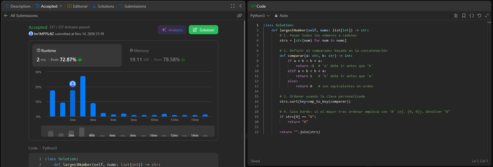

## 215. Kth Largest Element in an Array

- **Problema:** [215. Kth Largest Element in an Array](https://leetcode.com/problems/kth-largest-element-in-an-array/)
- **Autor:**  (`danielmmnez`)
- **Familia:** Heap 
- **Idea:** Mantenemos un min-heap acotado a un tamaño máximo `k`. Recorremos `nums`: mientras el heap tenga menos de `k` elementos, insertamos; si ya tiene `k` y el elemento actual supera a la raíz (el mínimo entre los `k` mejores candidatos), reemplazamos la raíz. Al finalizar, la raíz contiene el k-ésimo mayor.
- **Complejidad:** Tiempo `O(n log k)` y Espacio extra `O(k)`, donde `n = nums.length` y `k` es la capacidad máxima del heap.

## 179. Largest Number

- **Problema:** [179. Largest Number](https://leetcode.com/problems/largest-number/)
- **Autor:**  (`danielmmnez`)
- **Familia:** Ordenamiento
- **Idea:** Convertimos los enteros a cadenas y ordenamos mediante un comparador personalizado donde `a` precede a `b` si la concatenación `a + b` es lexicográficamente mayor que `b + a`. Finalmente concatenamos el arreglo ordenado y controlamos el caso borde donde todos los elementos son ceros devolviendo `"0"`.
- **Complejidad:** Tiempo `O(n log n · d)` (donde `n = nums.length` es la cantidad de números y `d` la longitud promedio de los dígitos al comparar cadenas) y Espacio `O(n)` para almacenar las cadenas y el resultado.

## 134. Gas Station

- **Problema:** [134. Gas Station](https://leetcode.com/problems/gas-station/)
- **Autor:**  (`danielmmnez`)
- **Familia:** Greedy
- **Idea:** Primero verificamos si `sum(gas) < sum(cost)`; de ser así, retornamos `-1`. Si alcanza, recorremos el circuito en una sola pasada acumulando `gas[i] - cost[i]` en el tanque. Cuando el tanque se vuelve negativo en el índice `i`, descartamos todo el tramo desde el inicio actual hasta `i` (pues haber llegado a cualquier estación intermedia de ese tramo nos aportó un excedente $\ge 0$, por lo que iniciar en ellas desde cero fallaría igual o antes) y fijamos `i + 1` como nuevo candidato con el tanque en `0`.
- **Complejidad:** Tiempo `Θ(n)` (una sola pasada sobre el circuito) y Espacio extra `Θ(1)`, donde `n = gas.length`.

